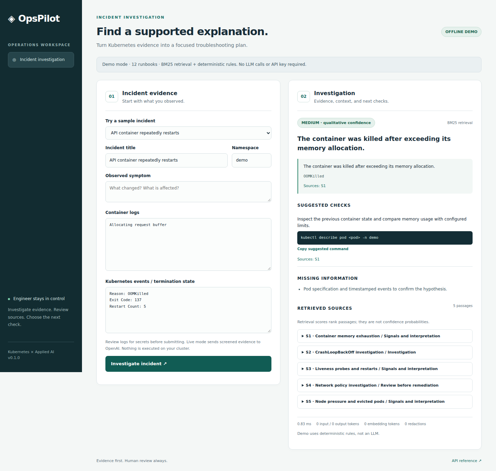
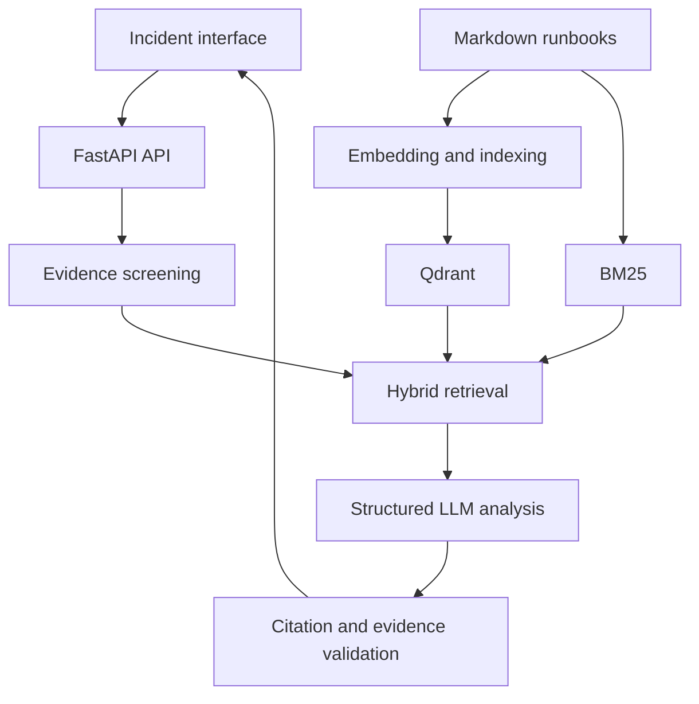

# OpsPilot

**Evidence-grounded Kubernetes incident investigation with RAG.**

OpsPilot combines incident logs and Kubernetes events with operational runbooks to suggest plausible causes and read-only troubleshooting checks. Engineers review every recommendation. The application cannot execute commands or modify a cluster.

Two deliberately distinct modes:

| Mode | Retrieval | Analysis | Requirements |
| --- | --- | --- | --- |
| `demo` | Local BM25 | Transparent deterministic rules | No API key, no vector server |
| `live` | OpenAI embeddings + Qdrant, fused with BM25 | OpenAI structured responses | OpenAI API key and a Qdrant service |

Demo mode demonstrates the workflow. It is **not** an LLM or semantic RAG benchmark.



## Quick start

Requires Python 3.11+ or Docker Compose. Run from the repository root.

### Docker: offline demo

```sh
cp .env.example .env
docker compose up --build -d
```

Open **http://localhost:8000**, choose a sample incident, and click **Investigate incident**. Docker Compose binds the application to loopback. The Qdrant service is not started in demo mode.

Windows PowerShell: replace `cp` with `Copy-Item`. Docker Desktop must be running.

### Python: offline demo

```sh
python -m venv .venv
# Linux/macOS:
source .venv/bin/activate
# Windows PowerShell instead:
# .\.venv\Scripts\Activate.ps1
python -m pip install -e '.[dev]'
python -m uvicorn app.main:app --host 127.0.0.1 --port 8000 --no-access-log
```

The Python server does not automatically load `.env`; demo is the default. To enable live mode locally, export the environment variables or use the Compose route below.

### Live RAG

Edit `.env` locally:

```dotenv
OPSPILOT_MODE=live
OPENAI_API_KEY=your-local-key
OPENAI_MODEL=gpt-4.1-mini
OPENAI_EMBEDDING_MODEL=text-embedding-3-small
OPENAI_EMBEDDING_DIMENSIONS=1536
```

Then start both services:

```sh
docker compose --profile live up --build -d
docker compose logs -f app
```

Set a model that your account can use and that supports structured outputs. Startup embeds the runbooks and persists them in Qdrant; later starts reuse the complete matching index. Changing runbooks, embedding model, or dimensions creates a new fingerprinted collection. Old collections are retained; remove them manually after verifying they are no longer needed.

For an existing external Qdrant deployment, set `QDRANT_URL` and `QDRANT_API_KEY`; start only the app with `docker compose up --build -d app`. Leave the key empty for the bundled private Qdrant service.

Live requests send best-effort-redacted incident content to OpenAI. Review logs yourself first. Credentials stay in environment variables and are not committed or sent to the browser. `store=False` is set for Responses requests; this is not a guarantee about all provider retention policies.

## What an investigation returns

- Concise summary and qualitative confidence, not a numerical probability.
- Hypotheses containing exact incident quotations and validated runbook citation IDs.
- Suggested read-only `kubectl` checks with supporting references.
- Explicit missing information and an insufficient-evidence path.
- Retrieved passages, latency, token counts, and best-effort redaction count.

Citation validation checks identifiers and exact evidence quotes. It does not prove that the model's reasoning or a cited passage actually supports a conclusion. The output requires engineer review.

## Architecture



Live retrieval uses reciprocal rank fusion of dense and lexical rankings. Demo uses only BM25 and rules. The model receives screened incident data and retrieved passages as data, with instructions to ignore embedded commands or role changes. No tools or write privileges are granted to it.

## API

| Endpoint | Purpose |
| --- | --- |
| `GET /` | Incident workspace |
| `POST /api/analyze` | Analyze a validated incident |
| `GET /api/examples` | Synthetic incidents |
| `GET /api/config` | Mode and knowledge-base size, no secrets |
| `GET /healthz` | Process health |
| `GET /readyz` | Startup/index readiness |
| `GET /metrics` | Prometheus counters and latency histogram |
| `GET /docs` | Interactive API reference |

```sh
curl -s http://localhost:8000/api/analyze \
  -H 'Content-Type: application/json' \
  -d '{"title":"API restarts","namespace":"demo","events":"Reason: OOMKilled","logs":"Allocating large buffer"}'
```

Set `OPSPILOT_API_TOKEN` before sharing the service. Protected endpoints require `Authorization: Bearer <token>`. The UI supports entering the token in page memory. Health/config and static assets remain public. This is a single-user portfolio service, not a multi-tenant product. For public hosting add HTTPS, ingress-level rate limits, and appropriate authentication.

## Tests and evaluation

```sh
ruff check .
ruff format --check .
pytest -q
python scripts/evaluate.py --mode demo --output evaluation/local-demo-results.json
```

Tests include API behavior, malformed input, redaction, fabricated quotes/citations, unsafe command suggestions, concurrency limits, actual in-memory Qdrant indexing/retrieval, and the OpenAI SDK request/response contract using mocked HTTP responses. They do not contact OpenAI or a Kubernetes cluster.

Optional browser checks (Node 22+ and the activated Python environment):

```sh
npm install
npx playwright install chromium
npm run test:browser
```

This starts its own offline server and verifies the diagnosis and insufficient-evidence flows at desktop/mobile widths. Screenshots are saved in `docs/assets/`. Node is not required to run the application.

The 18-case dataset is synthetic. Four variation fixtures and ambiguous/adversarial examples provide additional checks, but it is not an independent benchmark; the demo rules intentionally cover the known incident types. The report measures runbook hit@5, insufficient-evidence decisions, coarse cause-keyword matches, latency, and tokens. It does not measure real-world LLM accuracy.

`evaluation/demo-results.json` records one actual demo run. **Do not report these rule-based results as live-model performance.** Once live mode is configured, run:

```sh
python scripts/evaluate.py --mode live --output evaluation/local-live-results.json
```

The Python command uses environment variables, not the Compose `.env`. Query token totals exclude initial indexing; Prometheus tracks indexing separately. Live evaluation incurs model and embedding usage. Add independent incidents and manually review causal correctness, source support, and usefulness of the suggested checks before making accuracy claims.

## Kubernetes deployment and incident lab

See [the deployment guide](docs/DEPLOYMENT.md). It includes local Kind deployment, a live overlay, four intentional failures in a separate lab namespace, and a bounded read-only evidence collector. These manifests are provided for running locally; the lab has not been executed in the development environment.

```sh
python scripts/collect_incident.py memory-failure -n opspilot-lab --output incident.json
```

The collector uses your existing `kubectl` context and invokes only `describe` and bounded `logs` requests. It supports selecting a container. Review the generated file before sharing it.

## CI and observability

GitHub Actions runs linting, formatting, tests, and demo evaluation on Python 3.11/3.12, plus Chromium workflow checks. It builds and smoke-tests a Docker image, then publishes SHA-tagged and default-branch `latest` images to GHCR. No OpenAI secret is needed in CI. The workflow has not run until the project is uploaded to a GitHub repository.

Prometheus configuration and alert rules are in `observability/`. Metrics distinguish successful, failed, and busy requests; latency covers successful investigations. Token counts are tracked by input, output, query embeddings, and index embeddings. Incident text is not used in metric labels or normal application logs.

## Portfolio and interview notes

See [the walkthrough](docs/INTERVIEW.md) and [verification status](docs/VERIFICATION.md). The central engineering choices are retrieval grounding, structured outputs, validation, abstention, human control, and deployability. This project uses pretrained models through an API; it does not train a model or implement autonomous remediation.

License: [MIT](LICENSE).
